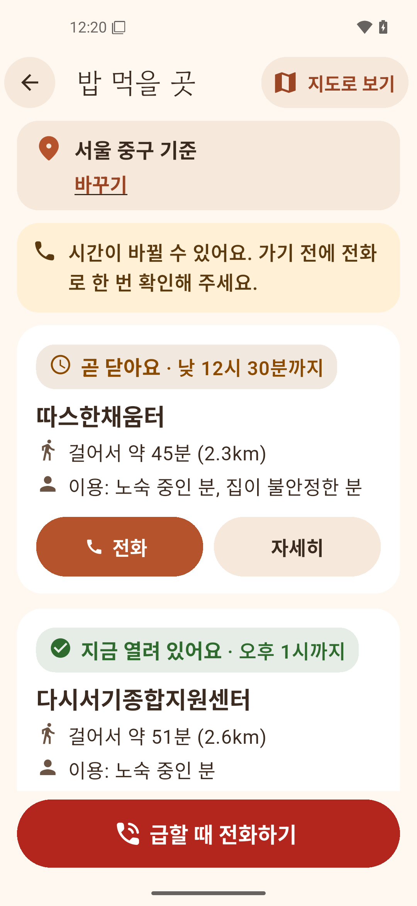
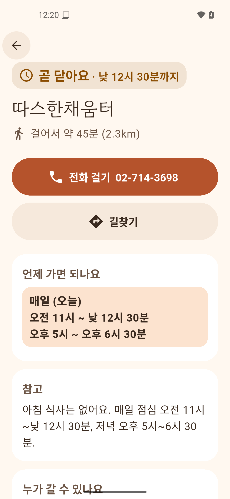
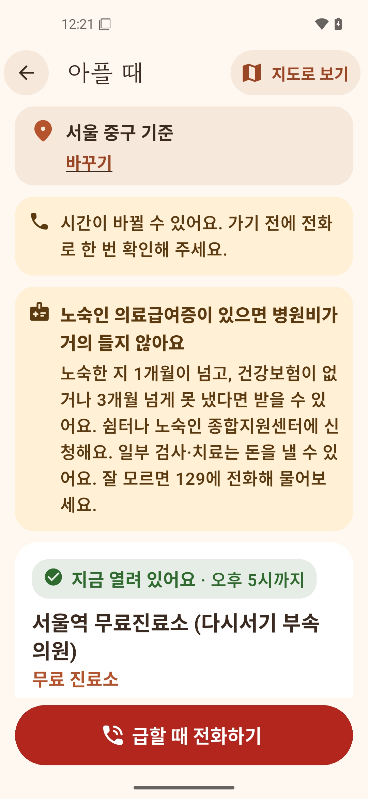
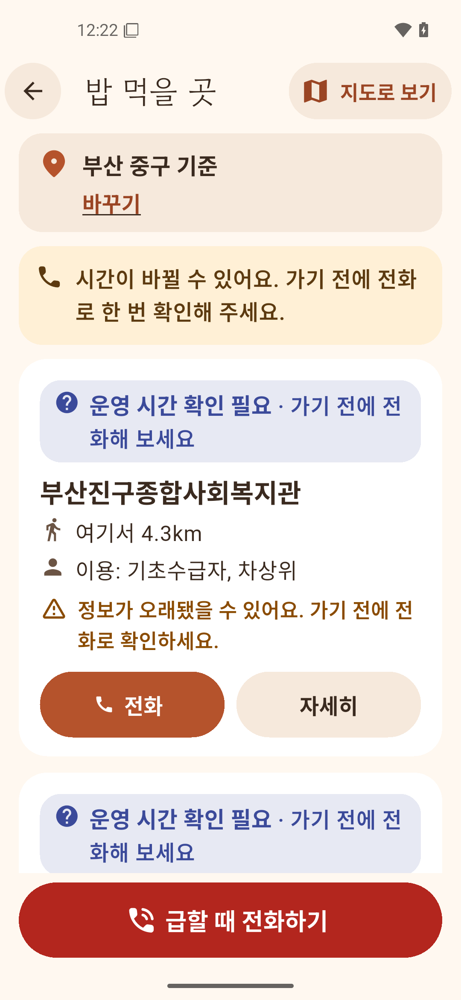
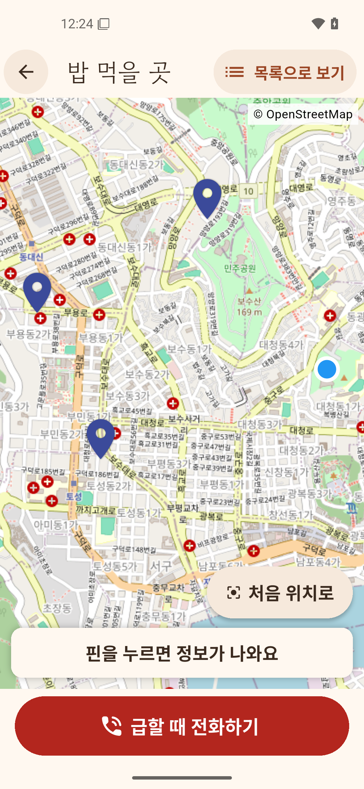
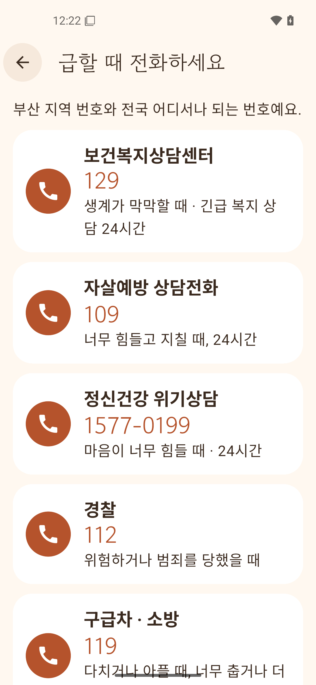

# 마중 - 무료급식·쉼터·진료 지도

지금 당장 밥 먹을 곳, 잘 곳, 아플 때 갈 곳이 필요한 사람이 **가장 가까운, 지금 열려 있는 곳**과 **전화 버튼**에 3번 터치 안에 닿게 하는 Android 앱입니다.

- 대상 지역: 전국 16개 시도 (위치 권한 없이 시·도 → 시·군·구로 골라도 됨)
- 1차 범위: 밥(무료급식) + 잠자리(노숙인 시설·쉼터) + 아플 때(무료 진료소·보건소)
- 지도는 열 때 기준 위치와 가장 가까운 3곳이 보이게 맞춥니다. "내 위치로"(GPS를 쓸 때는 위치를 한 번 새로 읽음) 또는 "처음 위치로"(지역을 골랐을 때) 버튼으로 언제든 되돌아옵니다
- 공공데이터 운영시간은 자주 틀려서, 사람이 확인한 곳만 "지금 열림"을 보여 줍니다 (`docs/decisions.md` #16)
- Flutter (Dart), 지도는 OpenStreetMap(`flutter_map`)

| 첫 화면 | 위치 정하기 (시·도 → 시·군·구) | 밥 먹을 곳 | 상세 |
|---|---|---|---|
|  |  |  |  |
| **아플 때** | **부산: 밥 먹을 곳** | **부산: 지도 (처음 위치로)** | **급할 때 전화** |
|  |  |  |  |

<sub>2026-11-04 평일 낮 12시 20분. 1~5는 서울 중구, 6~8은 부산 중구를 고른 화면. 서울 밥 목록은 사람이 확인한 운영시간이라 "지금 열려 있어요"가 나오고, 부산은 공공데이터뿐이라 "운영 시간 확인 필요"로 나옵니다.</sub>

## 디자인

지금 당장 도움이 필요한 사람이 쓰는 앱이라, 차갑지 않고 **따뜻하고 편안하게** 보이도록 만들었습니다.

- **아이콘**: 밤에 켜진 등불. '마중'처럼 누군가 불을 들고 기다리고 있다는 뜻
- **색**: 크림색 바탕, 테라코타 버튼, 진한 갈색 글자. 밥은 살구색, 잠자리는 연보라, 아플 때는 연초록. 어두운 모드는 따뜻한 짙은 갈색 (`app/lib/ui/theme.dart`)
- **모양**: 둥근 카드와 알약 모양 버튼, 테두리 선 대신 색을 채운 면
- **글꼴**: 큰 제목은 고운돋움, 본문은 휴대폰 기본 글꼴
- **말투**: 명령보다 권하는 말 ("어디로 갈까요?", "가기 전에 전화로 한 번 확인해 주세요")
- 따뜻한 색을 쓰더라도 글자 대비 4.5:1 이상, 터치 영역 48dp 이상, 글자 크기 200%는 지킵니다 (`docs/policy/ux-accessibility.md`)

## 지키는 원칙

자세한 규칙은 [`CLAUDE.md`](CLAUDE.md)와 [`docs/policy/`](docs/policy/)에 있습니다.

- 회원가입·로그인 없음
- 사용자 위치는 기기 밖으로 나가지 않음 (거리 계산·정렬은 기기에서). 위치 권한 없이도 지역 선택으로 모두 사용 가능
- 광고·행동 추적 SDK 없음, 백그라운드 위치 권한 없음
- 모든 시설 정보에 출처와 마지막 확인일 표시. 확인 안 된 정보는 확정처럼 보여주지 않음
- 오프라인에서도 목록·지도·전화번호 사용 가능
- 긴급 연락처는 항상 한 번에: 전국 공통(129, 109, 1577-0199, 112, 119)과 고른 지역 번호(서울 노숙인 위기대응콜 1600-9582, 경기 031-120 등)

## 폴더

| 폴더 | 내용 |
|---|---|
| `app/` | Flutter 앱 (`lib/config.dart`에 설정 한곳 모음) |
| `pipeline/` | 공공데이터 → 앱 데이터 변환 (Python 표준 라이브러리만) |
| `data/raw/` | 내려받은 원본 (날짜별) |
| `data/curated/` | 큰 원본에서 뽑은 작은 표(`derived/`), 주소→좌표 캐시, 공휴일 |
| `data/overrides/` | 사람이 확인한 보정·제외 (근거 URL·확인일 포함) |
| `data/research/` | 자료조사 결과 (출처 URL·확인 날짜) |
| `data/build-report.md` | 마지막 데이터 빌드 결과·전화 확인 목록 |
| `docs/policy/` | Play·개인정보·데이터·UX 정책 |
| `docs/decisions.md` | 결정 기록, 출시 전에 정해야 할 것 |
| `docs/store/` | Play 스토어 등록용 이미지 (아이콘 512px) |
| `tools/` | 아이콘 PNG·글꼴 다시 만들기 스크립트 |
| `docker/`, `compose.yaml` | 개발 환경 |

## 개발 환경 (Docker, 호스트에 Flutter·Android SDK 설치 안 함)

```bash
docker compose build dev                                      # 처음 한 번
docker compose run --rm -w /workspace/app dev flutter test    # 단위·위젯 테스트
docker compose run --rm -w /workspace/app dev flutter build apk --debug
```

**VS Code로 열기**: Dev Containers 확장을 설치하고 `Dev Containers: Reopen in Container`를 실행합니다 (`.devcontainer/`). 컨테이너 안에서 테스트·빌드를 할 수 있습니다. 에뮬레이터는 아래처럼 호스트 터미널에서 띄웁니다.

### 앱 띄워 보기

```bash
# PC 화면에 에뮬레이터 창을 띄워 앱 실행 (KVM·X11 필요)
# 터미널에서 r=핫 리로드, R=다시 시작, q=종료
docker compose build emulator                                 # 처음 한 번
docker compose run --rm emulator-gui

# USB로 연결한 실제 폰 (개발자 옵션 → USB 디버깅 켜기)
docker compose run --rm -w /workspace/app device flutter run
```

### 통합 테스트

```bash
# 헤드리스 에뮬레이터 (KVM 필요)
docker compose run --rm -w /workspace/app emulator bash -c "start-emulator && flutter test integration_test -d emulator-5554"
```

## 데이터 다시 만들기

```bash
python3 -I pipeline/build.py --today 2026-11-04 --version 2026-11-04T18:00:00+09:00
                                                   # app/assets/data/facilities.json, regions.json + data/build-report.md
python3 -I -m unittest discover -s pipeline/tests  # 파이프라인 테스트 (docker compose run --rm dev … 로도 됨)
python3 -I pipeline/extract.py centroids           # 큰 원본(SGIS 경계)이 바뀌었을 때만: 시군구 대표 좌표
python3 -I pipeline/extract.py hira                # 큰 원본(HIRA 병의원)이 바뀌었을 때만: 보건소·무료진료소 행
python3 -I pipeline/extract.py ssis                # data/raw/ssis-api_*/ 가 바뀌었을 때만: 전국 노숙인시설 표
python3 -I pipeline/geocode.py fetch --today 2026-11-04   # 좌표 없는 공식 주소만 OSM Nominatim으로 찾아 캐시 (인터넷 필요)
```

- 사회보장정보원 노숙인시설 API 키는 `.env`의 `SSIS_SERVICE_KEY`에만 둡니다(git 제외, decisions #17). 키는 원본을 받을 때만 쓰고, 받은 응답은 `data/raw/ssis-api_날짜/`에 저장합니다. 앱은 이 API와 통신하지 않습니다.
- `build.py`는 인터넷 없이 돌아갑니다. 주소로 찾은 좌표는 `data/curated/geocode-cache.json`에서 읽고, 앱 상세 화면에 "대략적인 위치"라고 표시합니다.

- 시설 정보는 최소 2개 독립 출처로 교차 확인합니다. 출처끼리 다르면 `data/research/`에 기록합니다.
- 사람이 확인한 보정(운영시간·전화·제외·급식 장소)은 `data/overrides/`에 근거 URL·확인일과 함께 둡니다. 공공데이터만 있는 시설은 운영시간을 구조화하지 않고 원문을 "공공데이터 안내: …"로 보여 줍니다(decisions #16).
- 큰 원본(SGIS 경계 SHP, HIRA CSV·ZIP, 10MB 넘는 PDF)은 커밋하지 않고(`.gitignore`, 출처 URL은 `data/research/`), `pipeline/extract.py`가 뽑은 작은 표(`data/curated/derived/`)만 커밋합니다.
- 결과는 `data/build-report.md`에서 확인합니다 (포함·제외·경고·전화 확인 필요 목록).

## 아이콘·글꼴 다시 만들기

호스트 Python으로 실행합니다 (`tools/launcher_icon.py`는 Pillow, `tools/subset_font.py`는 fontTools 필요).

```bash
python3 -I tools/launcher_icon.py                          # 구형 기기용 PNG + docs/store/icon-512.png
python3 -I tools/subset_font.py GowunDodum-Regular.ttf     # 제목 글꼴 줄이기 (7.2MB → 약 1.2MB)
```

- 아이콘 모양을 바꾸면 `app/android/app/src/main/res/drawable/ic_launcher_foreground.xml`(안드로이드 8 이상용 벡터)과 `tools/launcher_icon.py`를 함께 고칩니다.
- 글꼴은 한글 2,350자와 앱 문구·시설 데이터에 나오는 글자만 남깁니다. 시설 데이터에 드문 글자가 새로 들어오면 다시 만듭니다. 원본: [google/fonts](https://github.com/google/fonts/tree/main/ofl/gowundodum)

## 출시 전에 할 일

- [`docs/decisions.md`](docs/decisions.md)의 "출시 전에 다시 정해야 할 것": 패키지명 확정, 오류 신고 이메일, 전화 확인 담당, 비공개 테스터 12명, 위치정보법 검토
- 지도 타일 제공자 교체 (`app/lib/config.dart`, `data/research/map-osm.md`)

## 데이터 출처·저작권

- 시설 정보: 공공데이터포털(전국무료급식소표준데이터 등), 사회보장정보원 노숙인시설 API, 건강보험심사평가원 병의원 정보, 서울시·각 시도·구청 공개 자료 등. 지역 경계·대표 좌표는 통계청 SGIS, 법정동 코드는 국토교통부. 데이터셋별 출처와 이용 조건은 `data/research/`에, 시설별 출처는 앱 상세 화면과 정보 화면("데이터 출처")에 있습니다.
- 지도·주소 검색: © OpenStreetMap contributors (Nominatim 좌표는 데이터 만들 때만 사용)
- 글꼴: 고운돋움 (Gowun Dodum Project Authors, SIL Open Font License 1.1). 라이선스 원문은 `app/assets/fonts/GowunDodum-OFL.txt`
