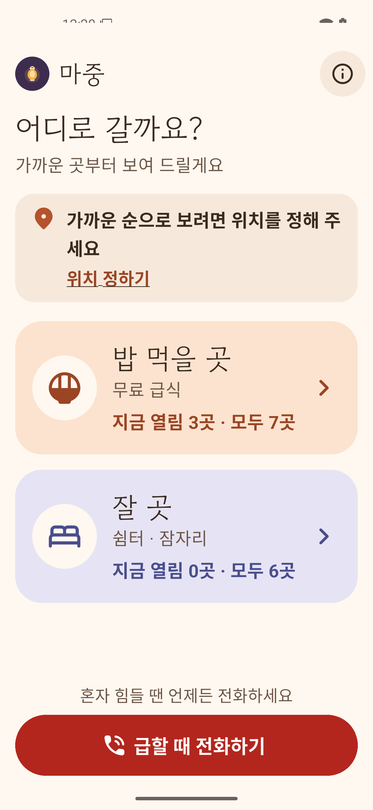
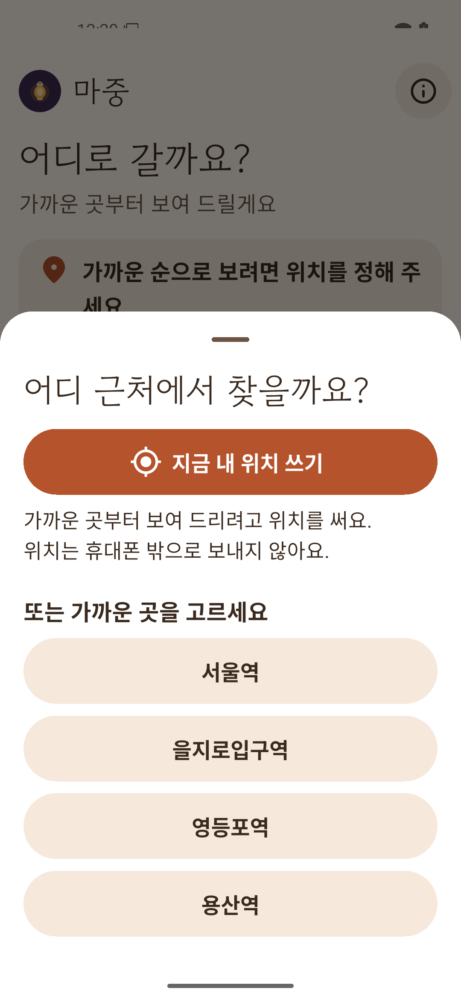
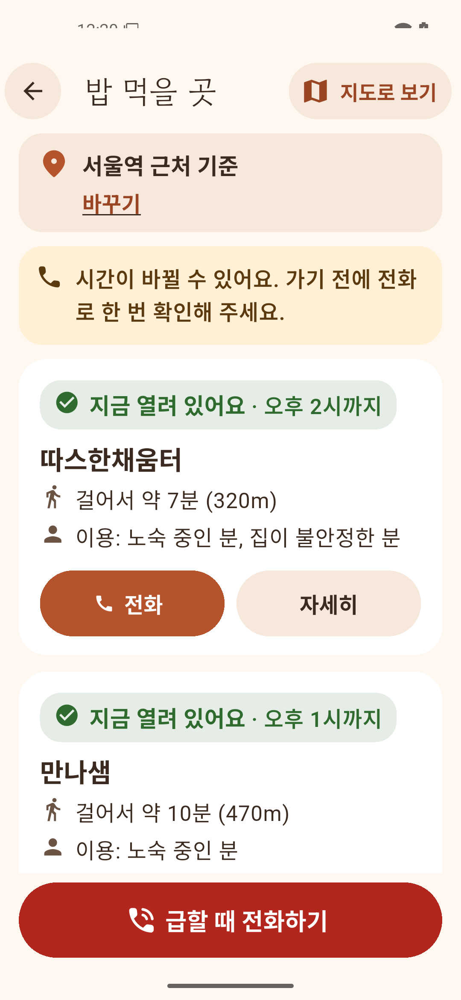
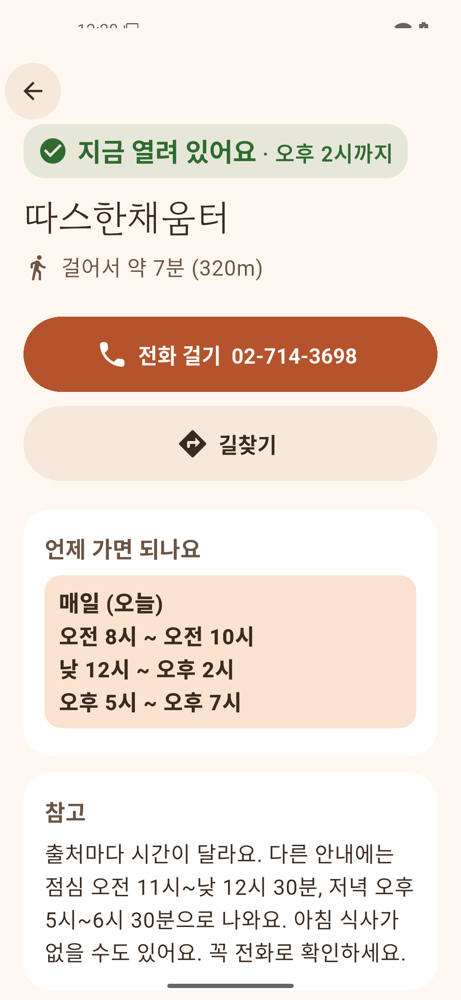
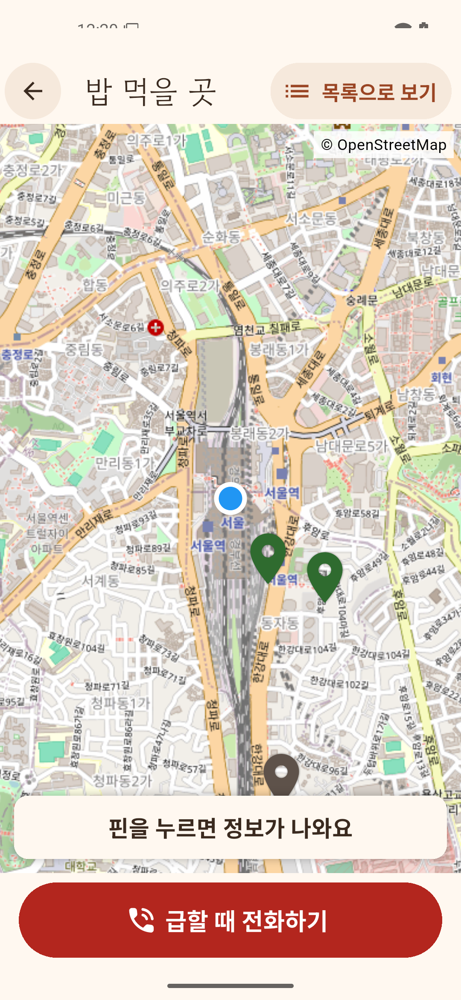

# 마중 - 무료급식·쉼터 지도

지금 당장 밥 먹을 곳, 잘 곳이 필요한 사람이 **가장 가까운, 지금 열려 있는 곳**과 **전화 버튼**에 3번 터치 안에 닿게 하는 Android 앱입니다.

- 1차 지역: 서울역·영등포·을지로
- 1차 범위: 밥(무료급식) + 잠자리(노숙인 시설·쉼터) — 2026-11-03 기준 13곳
- Flutter (Dart), 지도는 OpenStreetMap(`flutter_map`)

| 첫 화면 | 위치 정하기 | 목록 | 상세 | 지도 |
|---|---|---|---|---|
|  |  |  |  |  |

<sub>평일 낮 12시 20분, 서울역 근처 기준 화면 (2026-11-04)</sub>

## 디자인

지금 당장 도움이 필요한 사람이 쓰는 앱이라, 차갑지 않고 **따뜻하고 편안하게** 보이도록 만들었습니다.

- **아이콘**: 밤에 켜진 등불. '마중'처럼 누군가 불을 들고 기다리고 있다는 뜻
- **색**: 크림색 바탕, 테라코타 버튼, 진한 갈색 글자. 밥은 살구색, 잠자리는 연보라. 어두운 모드는 따뜻한 짙은 갈색 (`app/lib/ui/theme.dart`)
- **모양**: 둥근 카드와 알약 모양 버튼, 테두리 선 대신 색을 채운 면
- **글꼴**: 큰 제목은 고운돋움, 본문은 휴대폰 기본 글꼴
- **말투**: 명령보다 권하는 말 ("어디로 갈까요?", "가기 전에 전화로 한 번 확인해 주세요")
- 따뜻한 색을 쓰더라도 글자 대비 4.5:1 이상, 터치 영역 48dp 이상, 글자 크기 200%는 지킵니다 (`docs/policy/ux-accessibility.md`)

## 지키는 원칙

자세한 규칙은 [`CLAUDE.md`](CLAUDE.md)와 [`docs/policy/`](docs/policy/)에 있습니다.

- 회원가입·로그인 없음
- 사용자 위치는 기기 밖으로 나가지 않음 (거리 계산·정렬은 기기에서). 위치 권한 없이도 지역 선택으로 모두 사용 가능
- 광고·행동 추적 SDK 없음, 백그라운드 위치 권한 없음
- 모든 시설 정보에 출처와 마지막 확인일 표시. 확인 안 된 정보는 확정처럼 보여주지 않음
- 오프라인에서도 목록·지도·전화번호 사용 가능
- 긴급 연락처(노숙인 위기대응콜 1600-9582, 120, 112, 119 등)는 항상 한 번에

## 폴더

| 폴더 | 내용 |
|---|---|
| `app/` | Flutter 앱 (`lib/config.dart`에 설정 한곳 모음) |
| `pipeline/` | 공공데이터 → 앱 데이터 변환 (Python 표준 라이브러리만) |
| `data/raw/` | 내려받은 원본 (날짜별) |
| `data/curated/` | 사람이 검토한 보정·제외 (근거 포함) |
| `data/research/` | 자료조사 결과 (출처 URL·확인 날짜) |
| `data/build-report.md` | 마지막 데이터 빌드 결과·전화 확인 목록 |
| `docs/policy/` | Play·개인정보·데이터·UX 정책 |
| `docs/decisions.md` | 결정 기록, 출시 전에 정해야 할 것 |
| `docs/store/` | Play 스토어 등록용 이미지 (아이콘 512px) |
| `tools/` | 아이콘 PNG·글꼴 다시 만들기 스크립트 |
| `docker/`, `compose.yaml` | 개발 환경 |

## 개발 환경 (Docker, 호스트에 Flutter·Android SDK 설치 안 함)

```bash
docker compose build dev                                      # 처음 한 번
docker compose run --rm -w /workspace/app dev flutter test    # 단위·위젯 테스트
docker compose run --rm -w /workspace/app dev flutter build apk --debug
```

**VS Code로 열기**: Dev Containers 확장을 설치하고 `Dev Containers: Reopen in Container`를 실행합니다 (`.devcontainer/`). 컨테이너 안에서 테스트·빌드를 할 수 있습니다. 에뮬레이터는 아래처럼 호스트 터미널에서 띄웁니다.

### 앱 띄워 보기

```bash
# PC 화면에 에뮬레이터 창을 띄워 앱 실행 (KVM·X11 필요)
# 터미널에서 r=핫 리로드, R=다시 시작, q=종료
docker compose build emulator                                 # 처음 한 번
docker compose run --rm emulator-gui

# USB로 연결한 실제 폰 (개발자 옵션 → USB 디버깅 켜기)
docker compose run --rm -w /workspace/app device flutter run
```

### 통합 테스트

```bash
# 헤드리스 에뮬레이터 (KVM 필요)
docker compose run --rm -w /workspace/app emulator bash -c "start-emulator && flutter test integration_test -d emulator-5554"
```

## 데이터 다시 만들기

```bash
python3 -I pipeline/build.py                       # app/assets/data/facilities.json + data/build-report.md
python3 -m unittest discover -s pipeline/tests     # 파이프라인 테스트
```

- 시설 정보는 최소 2개 독립 출처로 교차 확인합니다. 출처끼리 다르면 `data/research/`에 기록합니다.
- 원본이 바뀌어 운영 문구가 달라지면 구조화된 운영시간을 버리고 "확인 필요"로 표시하며, 보고서에 경고를 남깁니다.
- 결과는 `data/build-report.md`에서 확인합니다 (포함·제외·경고·전화 확인 필요 목록).

## 아이콘·글꼴 다시 만들기

호스트 Python으로 실행합니다 (`tools/launcher_icon.py`는 Pillow, `tools/subset_font.py`는 fontTools 필요).

```bash
python3 -I tools/launcher_icon.py                          # 구형 기기용 PNG + docs/store/icon-512.png
python3 -I tools/subset_font.py GowunDodum-Regular.ttf     # 제목 글꼴 줄이기 (7.2MB → 약 1.2MB)
```

- 아이콘 모양을 바꾸면 `app/android/app/src/main/res/drawable/ic_launcher_foreground.xml`(안드로이드 8 이상용 벡터)과 `tools/launcher_icon.py`를 함께 고칩니다.
- 글꼴은 한글 2,350자와 앱 문구·시설 데이터에 나오는 글자만 남깁니다. 시설 데이터에 드문 글자가 새로 들어오면 다시 만듭니다. 원본: [google/fonts](https://github.com/google/fonts/tree/main/ofl/gowundodum)

## 출시 전에 할 일

- [`docs/decisions.md`](docs/decisions.md)의 "출시 전에 다시 정해야 할 것": 패키지명 확정, 오류 신고 이메일, 전화 확인 담당, 비공개 테스터 12명, 위치정보법 검토
- 지도 타일 제공자 교체 (`app/lib/config.dart`, `data/research/map-osm.md`)

## 데이터 출처·저작권

- 시설 정보: 공공데이터포털·서울시·각 구청 공개 데이터 등. 데이터셋별 출처와 이용 조건은 `data/research/`에, 시설별 출처는 앱 상세 화면과 정보 화면("데이터 출처")에 있습니다.
- 지도: © OpenStreetMap contributors
- 글꼴: 고운돋움 (Gowun Dodum Project Authors, SIL Open Font License 1.1). 라이선스 원문은 `app/assets/fonts/GowunDodum-OFL.txt`
